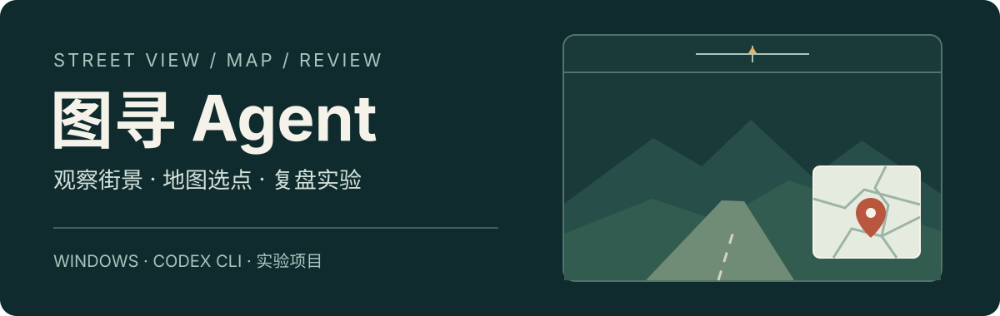

# 图寻 Agent

一个在 Windows 本机运行的视觉 Agent 实验。它观察街景和方位，在可见地图上选点，并记录从观察到提交的每一步。适合想研究**模型如何选点、执行层何时拦截动作、结果如何复盘**的开发者。游戏范围仅限图寻题库的经典五题，禁止用于每日挑战、匹配等竞技板块。

[English](README.en.md) · [快速开始](#快速开始) · [模式与边界](#模式与边界) · [离线复盘](#离线复盘) · [参与贡献](CONTRIBUTING.md) · [模型文档索引（llms.txt）](llms.txt)



一次中断的运行也可以复盘。例如，给复盘程序一份只有第三题得分的合成记录，它会保留第二题的缺失状态。以下两行来自实际的格式化输出。[复盘测试](test/review.test.mjs)

```text
第 2 题：结果未知（未记录）
第 3 题：7/5000；距离 未知；耗时 未知；模型调用 0 次；记录 token 未知；兜底状态未知
```

## 快速开始

### 先做离线检查

在 Windows 上安装 Node.js 22 或以上版本，在项目根目录打开 PowerShell。离线测试可直接运行：

```powershell
npm test
```

测试使用合成记录和本机接口，不访问图寻，也不调用模型。准备运行真实游戏时，先安装 Google Chrome，在项目根目录运行 `npm ci --ignore-scripts` 安装固定的 Codex CLI 0.170.0，再运行 `npm run doctor` 核对 Codex 路径、版本和 Chrome 文件。已有 Codex 登录可复用，需要登录时运行 `.\node_modules\.bin\codex.cmd login`。网站计时和 Chrome 能否启动仍需自行确认。Chrome 安装在其他位置时可设置 `CHROME_PATH`。

### 运行一局经典五题

1. 运行 `npm run browser` 打开专用 Chrome。在[图寻题库](https://tuxun.fun/map)手动登录，选择模式、设置轮次时间并开始首局。保持单个游戏标签页，窗口足够大且未最小化。
2. 运行 `npm run dashboard`，打开终端打印的本机地址。核对网页模式与计时、局数、单题时间及操作预算。默认一局，每题 5 分钟、35 次操作，每局 30 分钟；网站轮次时间应与单题预算相符。
3. **在控制台确认并启动后，Agent 会提交真实选点。** 决策截图、观察、动作历史和核对目标会发送给已登录的 Codex CLI 后端，可能产生费用。需要结束时先在控制台停止，等运行退出后执行 `npm run stop` 关闭专用浏览器。[数据与报告安全](SECURITY.md)

控制台和 CLI 默认向 Codex 请求 `gpt-6-astra`，推理强度为 `high`。可在启动前修改“请求模型”和“推理强度”，或在命令行传入 `--model gpt-5.6-sol --reasoning-effort low`。街景、地图及选点核对共用本次配置。

2026-11-19 的合成图线上核验中，测试账号使用默认组合和 `gpt-6.2-astra / high` 均正确识别了颜色。10 个模型均接受 `low`、`medium`、`high`、`xhigh`，均拒绝 `minimal`。[各模型实测结果与版本差异](CONTRIBUTING.md#模型与推理强度兼容性)

<details>
<summary>使用 CLI、后台 Chrome 或连续多局</summary>

手动开局后可运行 `npm run headless`，用同一配置切换至后台 Chrome。CLI 默认固定模式；以下示例要求网页已选固定视角，并已授权连续两局。CLI 的时间单位是秒，`--total-seconds` 按每局重置。

```powershell
npm run run -- --mode fixed-view --games 2 --round-seconds 300 --total-seconds 1800 --max-actions 35
```

`npm run run -- --help` 可离线查看参数。运行时按 Ctrl+C 请求停止。第五题结束后，程序只尝试一次重开并核对新局首题；网站模式与计时仍需核实。`--verify-current` 会提交当前选点并尝试翻页，即使没有模型调用，也需要真实操作授权。

</details>

## 模式与边界

| 网页与 CLI 模式 | 街景转向、缩放 | 街景移步 |
|---|---|---|
| 固定 `fixed`（默认） | 允许 | 禁止 |
| 移动 `move` | 允许 | 点击可见箭头或道路 |
| 固定视角 `fixed-view` | 禁止 | 禁止 |

三种模式都允许展开地图、缩放、调整窗口、选点和改选，均禁止拖动地图。执行层先检查动作是否符合模式，再核对可见目标。程序无法可靠区分网页上的固定与固定视角，移动模式还须看到移动箭头。请自行确认并遵守平台规则。[图寻主页](https://tuxun.fun/) · [图寻说明](https://www.yuque.com/chaofun/tuxun)

**模型看什么。** 输入来自可见街景、顶部方位和地图。题库名称、隐藏答案、网络响应和上一题的结果页都不能作为定位线索。地图专用步骤只取本步地图局部图。选点后的核对也可能误判边界或地名。

**何时提交或停止。** 收尾时优先提交已有图钉，没有图钉时可尝试可见地图中心。日志记录兜底原因。时间或操作预算耗尽、模式无法确认、截图或输入确认失败时，硬性保护优先。停止会阻止新输入；此前已发出的动作可能完成，结果不明时保留未知。CLI 与控制台共享同一浏览器互斥锁。[执行与故障说明](CONTRIBUTING.md#运行行为与故障定位)

## 离线复盘

运行会在 `artifacts/runs/` 下保存事件、报告和截图。已有记录时，运行以下命令读取最近一次；也可在命令后用 `--` 指定运行目录。

```powershell
npm run review
```

事件文件 `events.jsonl` 在运行开始和每次模型调用的开始、完成或失败事件中保存 `request_config.model` 和 `request_config.reasoning_effort`。同一事件的 `codex_cli` 记录经过版本检查的项目本地可执行文件路径和版本。这两项请求参数表示发给 CLI 的配置，旧日志缺失时保持未知。

CLI 按局、题列出得分、耗时、模型调用和兜底原因。要看某次动作对应的画面，在控制台的复盘页选择包含 `events.jsonl` 和截图的本地目录。两种方式都不访问游戏或调用模型。用量未知或统计口径混合时会标明，token 数不能直接换算费用。[回放操作与显示限制](test/UI_UX_ACCEPTANCE.md#控制台行为参考)

## 验证状态与文档

历史真实运行覆盖了三个模式和有限题库的多局流程；移动后的画面变化不能确认真实移步。后续提示、页面识别、核对和截图保护的修改经过离线验证，当前版本在真实页面上的效果仍待核实。新版控制台有 340 组模拟布局检查，真实对局体验、可公开的脱敏回放和演示视频仍待验证或制作。

| 你想了解什么 | 从这里开始 |
|---|---|
| 改动一个模块，选择对应的测试 | [贡献指南与验证入口](CONTRIBUTING.md#按改动选择验证) |
| 查看控制台布局、回放和验收依据 | [UI 验收记录](test/UI_UX_ACCEPTANCE.md) |
| 理解三种模式、证据和预算的设计取舍 | [项目决策记录](docs/DECISIONS.md) |
| 在仓库内协作，或私下报告安全问题 | [Agent 协作约定](AGENTS.md) · [安全说明](SECURITY.md) |

代码使用 [MIT 许可证](LICENSE)。
